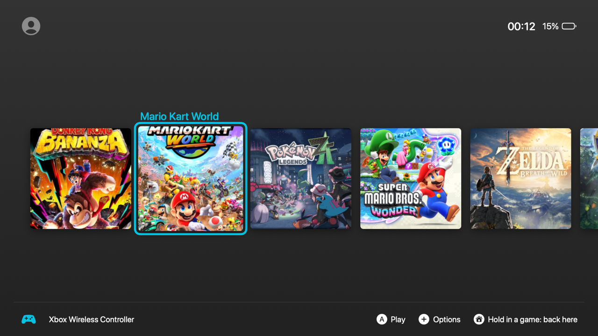
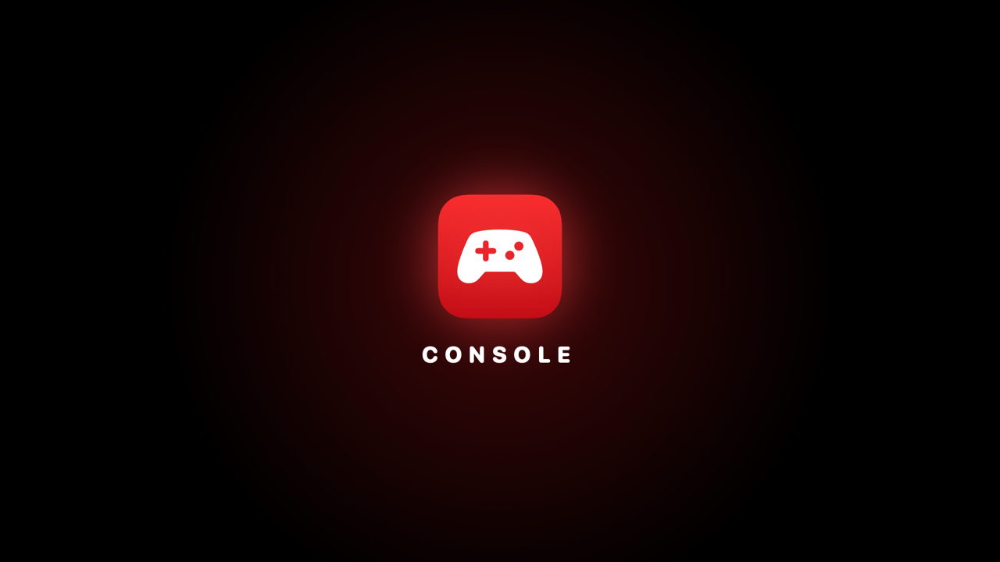
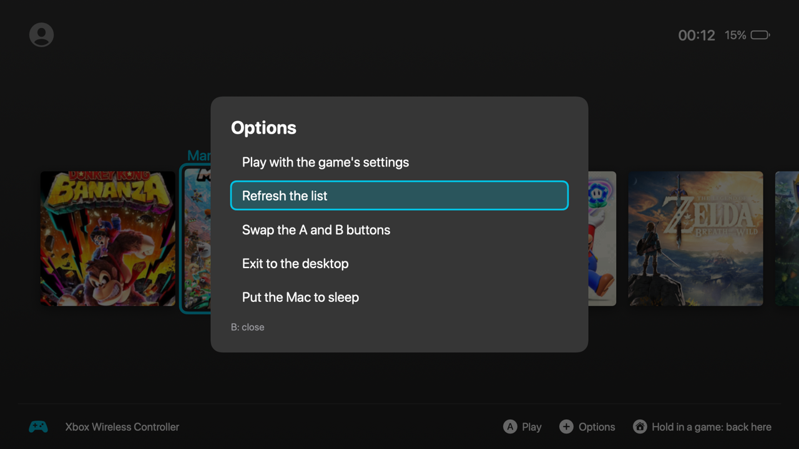

# NX Native Launcher

**Console** is a home screen for the games you built with [nxnative](https://github.com/seedds/nxnative). It shows them as a row of covers, like a console's home screen, and you drive it with a game controller. Plug the Mac into the TV, turn on the controller, pick a game.



## What it does

- **Finds your games by itself.** Every app nxnative built (`org.nxnative.*`) in `/Applications` or `~/Applications` shows up, with its icon as the cover. The game you played last comes first.
- **Comes up when a controller connects.** It waits in the background from login and opens full screen when you turn on a Bluetooth or USB controller. With a TV or monitor plugged in, it opens on that screen, not on the Mac's own.
- **Starts the game straight away.** A opens the selected game with the settings you saved in its launcher, without showing the settings window. When the game ends, you are back on the home screen.
- **Goes back home from a game.** Hold HOME for about a second in a game to quit it and come back. After you exit to the desktop, a press of HOME or OPTIONS (+) brings Console back.
- **Turns the controller off.** Choose **Turn off the controller and exit** (or put the Mac to sleep from the options) and the Bluetooth controller goes to sleep.
- **Speaks your Mac's language.** English, Spanish, French, German, Italian and Portuguese, following System Settings › General › Language & Region; English for any other language.
- **Has an opening animation** when it comes up.

| Opening | Options |
|---|---|
|  |  |

## Requirements

- An Apple silicon Mac with **macOS 14** or later.
- **Xcode** or its command line tools (`xcode-select --install`), which you already have if you build games with nxnative.
- Games built with nxnative as Mac apps (`--platform mac-app`) in `/Applications` or `~/Applications`.
- A game controller macOS supports: Xbox, PlayStation, Nintendo Switch Pro Controller and Joy-Con, or another MFi controller.

## Install

```bash
git clone https://github.com/vTanco/nxnative-launcher.git
cd nxnative-launcher
./install.sh
```

The script builds Console on your Mac, installs it in `/Applications` and adds a login agent so it waits in the background. Because it is built on your own Mac, Gatekeeper does not block it. `./install.sh --no-autostart` installs the app without the login agent; then you open Console yourself.

To update, run `git pull` and `./install.sh` again. To remove it, run `./uninstall.sh` (your games are not touched).

## Controls

| Controller | Keyboard | |
|---|---|---|
| D-pad or left stick | ← → | Choose a game |
| A | Return | Play |
| + (Menu / Options) | Tab | Options |
| B | Esc | Close the options |
| Hold HOME in a game | | Quit the game and come back |
| HOME or OPTIONS (+), on the desktop | | Bring Console back |
| | Esc on the home screen | Exit to the desktop |

On Nintendo controllers, A is the right-hand button, as on the Switch; on others it is the bottom one. If they come out swapped, choose **Swap the A and B buttons** in the options.

**Options:** play with the game's settings window (to change resolution, frame rate and so on before playing), refresh the list, swap A and B, exit to the desktop, turn off the controller and exit, put the Mac to sleep (which turns the controller off too).

Turning the controller off closes its Bluetooth connection, so the first time macOS asks to let Console use Bluetooth. A USB controller stays on.

## Tips

- **HOME opens Launchpad or the Games app?** macOS can keep the controller's HOME button for itself, and then no app sees it. Turn that off in System Settings › Game Controllers › your controller, so holding HOME in a game reaches Console. On the desktop, OPTIONS (+) brings Console back either way.
- **Log.** `~/Library/Logs/Console/console.log` records controllers connecting and disconnecting and why Console came up or not.
- **Quitting a game with HOME** is like pressing ⌘Q: progress the game has not saved is lost, as on a console.
- **Games from other ports.** To list an app that nxnative did not build, put its bundle identifier on a line of `~/Library/Application Support/Console/extra.txt` (find it with `osascript -e 'id of app "App Name"'`), then choose Refresh the list.
- **Notification banners.** While Console is in front it closes the banners in the top right corner (a controller cannot reach their close button). That needs Accessibility: macOS asks the first time Console comes up; turn Console on in System Settings › Privacy & Security › Accessibility. Signed ad hoc, each build is a new app to macOS and the permission is lost at every update: run `scripts/make-signing-identity.sh` once (it makes a self-signed code signing certificate in your login keychain; no Apple account) and `./install.sh` signs Console with it, so the permission stays. If you had already allowed an older build, remove Console from the Accessibility list and allow it again.
- **No notifications while you play.** Add the **Gaming** Focus in System Settings › Focus and turn it on automatically *when a game controller is connected*: it comes on with Console and goes off with the controller.
- **A console-like setup.** Keep the Mac on a USB-C dock with power and HDMI. Turn on the controller and Console comes up on the TV.

## How it works

Console is one Swift file ([`Sources/main.swift`](Sources/main.swift)): SwiftUI for the screen, the GameController framework for the controller (with background monitoring, so HOME works while a game is in front), and the nxnative launcher's own `window.show` preference to skip its settings window. It is put back when the game ends, so opening a game from Finder still shows its settings.

`./build.sh` builds `build/Console.app` without installing it. `Console --snapshot file.png [--menu] [--intro] [--lang xx]` draws the screen into a PNG at 1920x1080 and exits.

## License

MIT. Console is not affiliated with Nintendo or with the nxnative project. It only launches the apps you built yourself.
